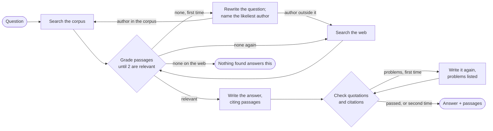

# AporiaRAG: Corrective RAG over Primary Philosophical Texts

A question-answering agent over twelve classic works of philosophy that **checks its own work**: it
grades every passage it retrieved, searches again in the corpus's own words or on the web when
nothing answers, checks that every quotation and citation in its answer is borne out by its
passages, and writes the answer once more when one is not. It runs locally on open models, and a
web page shows each step as it happens.


## Results

Measured on 49 hand-written questions, against plain RAG (retrieve 5 passages, answer from all of
them) with the same models and prompt ([details and method](docs/experiments.md)):

| | plain RAG | corrective RAG |
|---|---|---|
| share of the passages given to the model that answer the question | 0.55 | 0.91 |
| questions outside the corpus answered from passages that cannot answer them (of 4) | 4 | 0 |
| answers with a quotation or citation not borne out by its passages | 15 of 49 | 1 of 48 |
| answers with an error found by a blind reading (15 questions) | 10 of 15 | 3 of 15 |
| median seconds per question, on a laptop | 9.5 | 11.9 |

The extra 2.4 s buy answers written from passages that answer the question, an honest "nothing
found answers this" instead of an answer from the wrong book, and quotations that are in the text.
A second run of all 49 questions gave the same first two rows, 22 and 2 answers with a quotation
or citation not borne out, and 9.9 s and 11.4 s: the gap holds, the exact counts vary from run to
run.

## Why "corrective"?

Plain RAG is open-loop: embed the question, fetch the top-k passages, generate. When retrieval
misses, the model writes from whatever came back, and nothing notices.

Philosophy makes this failure common and subtle. Kant and Mill both write at length about *duty*;
Plato and Aristotle both write about *the good* and mean different things by it; a chapter on
honour is "near" a question about the dishonourable. Retrieval regularly returns passages that are
on the topic but do not answer. And philosophers state views in order to reject them, so even the
right passage can be misread. This project closes the loop with explicit grading, correction and
checking steps, after Corrective RAG ([Yan et al., 2024](https://arxiv.org/abs/2401.15884)) and
Self-RAG ([Asai et al., 2023](https://arxiv.org/abs/2310.11511)).

## How it works



Every loop runs at most once, so the agent always ends. A question that names authors ("How do
Kant and Mill differ on lying?") is asked of each author on their own. The model calls go where
they are needed: on the normal path, one verdict per passage until two are relevant, and one answer.
See [architecture](docs/architecture.md) for the design, and [experiments](docs/experiments.md)
for what each choice was measured against.

## Corpus

Twelve public-domain works from [Project Gutenberg](https://www.gutenberg.org), chosen so that the
same words mean different things to different authors: *duty* for Cicero, Kant and Mill;
*happiness* for Aristotle, Seneca, Mill and Schopenhauer; *will* and *idea* for Plato, Kant and
Schopenhauer.

| Theme | Works |
|---|---|
| Ethics and how to live | Aristotle, *Nicomachean Ethics* (tr. Chase) · Cicero, *De Officiis* (tr. Miller) · Seneca, *Minor Dialogues* (tr. Stewart) · Kant, *Fundamental Principles of the Metaphysic of Morals* (tr. Abbott) · Mill, *Utilitarianism* · Nietzsche, *The Genealogy of Morals* (tr. Samuel) |
| Knowledge and reality | Descartes, *Discourse on the Method* (tr. Veitch) · Hume, *An Enquiry Concerning Human Understanding* · Schopenhauer, *The World as Will and Idea*, Vol. 1 (tr. Haldane & Kemp) |
| Justice and the state | Plato, *Republic* (tr. Jowett) · Hobbes, *Leviathan* · Mill, *On Liberty* |

Only the authors' own words are indexed: each edition's layout (in
[`corpus.toml`](src/aporia_rag/ingestion/corpus.toml)) cuts away translators' introductions, notes,
indexes and appended works (Jowett's introduction alone is 46% of the *Republic* file), and the Latin
half of the bilingual *De Officiis* is dropped. The result is 245 sections and 7,705 passages, each
cited by author, work and section.

## Tech stack

All free, all local by default.

| Concern | Choice |
|---|---|
| Chat model | [Ollama](https://ollama.com) running `qwen3.5:35b-a3b` (mixture of experts: about 3B of its 35B parameters per token) |
| Embeddings | [`qwen3-embedding:0.6b`](https://ollama.com/library/qwen3-embedding) via Ollama |
| Orchestration | [LangGraph](https://langchain-ai.github.io/langgraph/) state machine |
| Vector store | [Chroma](https://www.trychroma.com), embedded, on disk |
| Web fallback | [`ddgs`](https://pypi.org/project/ddgs/), no API key |
| Web UI | [FastAPI](https://fastapi.tiangolo.com) streaming each step; one HTML page, plain CSS and JavaScript |
| Tooling | `uv`, `pytest` + Hypothesis, `ruff`, `mypy --strict`, import-linter, GitHub Actions |

## Getting started

Prerequisites: [uv](https://docs.astral.sh/uv/) and [Ollama](https://ollama.com). The chat model
needs 32 GB of RAM; with 16 GB, set `APORIA_CHAT__MODEL=qwen3.5:9b-q4_K_M`.

```bash
ollama pull qwen3-embedding:0.6b       # the embedding model (639 MB)
ollama pull qwen3.5:35b-a3b-q4_K_M     # the chat model (22 GB)

make install                           # create .venv and install from the lockfile
uv run aporia-rag fetch                # download the 12 works into data/raw (cached afterwards)
uv run aporia-rag index                # embed them into the vector index in data/index

uv run aporia-rag serve                # the web UI on http://127.0.0.1:8000
uv run aporia-rag ask "Is lying ever right?"
```

More from the command line:

```bash
uv run aporia-rag search "What is justice?" --author plato   # what retrieval alone finds
uv run aporia-rag ask "What is friendship?" --all-authors    # one section per author
uv run aporia-rag ask "Is lying ever right?" --others        # ...and other authors who discuss it
uv run aporia-rag ask "How do Kant and Mill differ on lying?"
uv run aporia-rag ask "What is a language game?"             # outside the corpus: the web

uv run aporia-rag evaluate            # Hit@k and MRR of retrieval on the 40 gold questions
uv run aporia-rag evaluate --grade    # ...and the relevance grader against the gold set
uv run aporia-rag evaluate --gold src/aporia_rag/evaluation/gold_retrieval.toml \
    --gold src/aporia_rag/evaluation/gold_loop.toml --answers data/eval/answers.jsonl
                                      # plain vs. corrective RAG on all 49 questions (~20 min)
```

`ask` prints the answer, its numbered passages, the passages left out as not relevant and those not
graded, any rewrite or web search and why, the checks, and the time each step took. Only when the
corpus has no answer does a question leave the machine.

## Configuration

Every setting has a local default. Override any of them with an environment variable or a `.env`
file (see [`.env.example`](.env.example)):

```bash
APORIA_EMBEDDING__MODEL=embeddinggemma:300m   # section, two underscores, field
APORIA_OLLAMA__HOST=http://gpu-box:11434
APORIA_CHAT__MODEL=qwen3.5:9b-q4_K_M          # for machines with 16 GB of RAM
```

Models, stores and the web search are chosen by name (`APORIA_EMBEDDING__PROVIDER`,
`APORIA_CHAT__PROVIDER`, `APORIA_STORAGE__PROVIDER`, `APORIA_WEB__PROVIDER`). Only Ollama, Chroma and
ddgs exist today, but the code depends on interfaces, not on them: adding Google, Voyage AI or
Anthropic is one adapter class and one registration
([architecture](docs/architecture.md#providers-ports-adapters-registries)). Each embedding model
gets its own index, so switching models never mixes vectors.

## Development

Built test-first: for every component, the tests were listed in
[`docs/test-plan.md`](docs/test-plan.md) before they were written, then the component, then the
full gate. Decisions that rest on an assumption were measured first, with the rule fixed before
the run ([experiments](docs/experiments.md)).

| Command | Runs |
|---|---|
| `make check` | What CI runs: lint, `mypy --strict` on source and tests, the unit suite with branch coverage (100%), the import rules |
| `make test-llm` | Tests against the real local models. Slow, run by hand before a commit. |
| `make test-integration` | Contract tests on the real downloaded corpus, plus a live mirror download and web search. |

## Limitations

- A view an author reports and then rejects can still be given as his own, when the passage starts
  mid-argument; 3 of 15 corrective answers had an error found only by reading.
- A model check of every sentence was measured and dropped: the local model found 1 of 6 such
  errors.
- Runs are not fully repeatable on Ollama, even at temperature 0.
- One side of a comparison can be lost when that author's best passage on the subject is elsewhere.
- One question, one answer: each question is answered on its own, so "And Mill?" after a question
  about Kant is searched as written. Reading follow-ups in context was measured and left for later
  ([experiments](docs/experiments.md#follow-up-questions-2026-10-22)).
- Measured with one 35B model on one laptop; the 9B setting is untested.

More in [architecture](docs/architecture.md#known-limitations).
