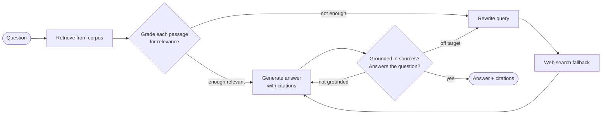

# AporiaRAG: Corrective RAG over Primary Philosophical Texts

A question-answering agent that answers from the primary texts of Western philosophy, and
**checks its own work** before answering: it grades what it retrieved, rewrites the query or
falls back to a web search when the corpus does not cover the question, and verifies that the
final answer is grounded in its sources. Everything runs locally on open models; nothing costs money.

> **Status:** early development. See [Roadmap](#roadmap).

## Why "corrective"?

Plain RAG is open-loop: embed the question, fetch the top-k passages, generate. When retrieval
misses, the model either hallucinates or gives up, and nothing notices.

Philosophy makes this failure common and subtle. Kant and Mill both write at length about
*duty*; Plato and Aristotle both write about *the good*, and mean different things by it. Cosine
similarity cannot tell which one the user is asking about, so retrieval regularly returns passages
that are on-topic but wrong. This project closes the loop with explicit grading and correction
steps, based on the Corrective RAG ([Yan et al., 2024](https://arxiv.org/abs/2401.15884)) and
Self-RAG ([Asai et al., 2023](https://arxiv.org/abs/2310.11511)) patterns.

## How it works



Every loop has a hard retry cap, so the agent always terminates, with an honest "I don't know"
if it has to.

## Corpus

Twelve public-domain works from [Project Gutenberg](https://www.gutenberg.org), chosen so that the
same words mean different things to different authors: *duty* for Cicero, Kant and Mill;
*happiness* for Aristotle, Seneca, Mill and Schopenhauer; *will* and *idea* for Plato, Kant and
Schopenhauer. Telling those meanings apart is exactly what the relevance grader has to do.

| Theme | Works |
|---|---|
| Ethics and how to live | Aristotle, *Nicomachean Ethics* (tr. Chase) · Cicero, *De Officiis* (tr. Miller) · Seneca, *Minor Dialogues* (tr. Stewart) · Kant, *Fundamental Principles of the Metaphysic of Morals* (tr. Abbott) · Mill, *Utilitarianism* · Nietzsche, *The Genealogy of Morals* (tr. Samuel) |
| Knowledge and reality | Descartes, *Discourse on the Method* (tr. Veitch) · Hume, *An Enquiry Concerning Human Understanding* · Schopenhauer, *The World as Will and Idea*, Vol. 1 (tr. Haldane & Kemp) |
| Justice and the state | Plato, *Republic* (tr. Jowett) · Hobbes, *Leviathan* · Mill, *On Liberty* |

Only the authors' own words are indexed. Each edition's layout (in
[`corpus.toml`](src/aporia_rag/ingestion/corpus.toml)) cuts away translators' introductions, notes,
indexes and appended works. Jowett's introduction alone is 46% of the *Republic* file. Footnotes
and apparatus are removed, and the Latin half of the bilingual Loeb *De Officiis* is dropped. The
result is 245 sections, each cited by author, work, translator and section ("Book IV",
"Section VII, Part II", "Part II. Of Common-wealth, Chapter XVII...").

## Tech stack

All free, all local by default.

| Concern | Choice |
|---|---|
| LLM | [Ollama](https://ollama.com) running `qwen3.5:35b-a3b` (mixture of experts: ~3B of its 35B parameters per token) |
| Embeddings | [`qwen3-embedding:0.6b`](https://ollama.com/library/qwen3-embedding) via Ollama |
| Orchestration | [LangGraph](https://langchain-ai.github.io/langgraph/) state machine |
| Vector store | [Chroma](https://www.trychroma.com) (embedded, on disk) |
| Web fallback | [`ddgs`](https://pypi.org/project/ddgs/) (no API key) |
| Corpus | [Project Gutenberg](https://www.gutenberg.org) public-domain texts |
| Tooling | `uv`, `pytest` + Hypothesis, `ruff`, `mypy --strict`, GitHub Actions |

## Getting started

Prerequisites: [uv](https://docs.astral.sh/uv/) and [Ollama](https://ollama.com).

```bash
ollama pull qwen3-embedding:0.6b  # the embedding model (639 MB)
ollama pull qwen3.5:35b-a3b-q4_K_M   # the chat model (22 GB; needs 32 GB of RAM)

make install                      # create .venv and install from the lockfile
uv run aporia-rag fetch           # download the 12 works into data/raw (cached afterwards)
uv run aporia-rag index           # embed them into the vector index in data/index
uv run aporia-rag search "Is anything good without qualification?" -k 5
uv run aporia-rag search "What is justice?" --author plato
uv run aporia-rag ask "Is anything good without qualification?"
uv run aporia-rag ask "What is friendship?" --all-authors
uv run aporia-rag ask "How do Kant and Mill differ on lying?"
uv run aporia-rag evaluate        # Hit@k and MRR of retrieval on 40 gold questions
make check                        # lint, strict type-check, tests with coverage: what CI runs
make help                         # list all targets
```

`index` only embeds what is new or changed, so running it again is cheap; `index --rebuild`
starts over. `search` shows what retrieval alone finds, with similarity scores and citations.
`ask` keeps the passages the chat model judges relevant and has it answer from them, citing them as
`[1]`, `[2]`...; under the answer it lists the passages used, the ones left out as not relevant, the
other authors in the corpus who discuss the question, and the time each step took. When no passage
is relevant, it says so instead of answering. `ask --all-authors` grades the best passage of every
author and answers with one section per author, headed by the author and the passage number
(about a minute on a laptop). A question that names authors is answered from those authors only:
one named author as with `--author` ("What does Kant say about lying?"), two or more as a survey of
them ("How do Kant and Mill differ on lying?").

## Configuration

Every setting has a local default; nothing needs configuring to start. Override any of them with
an environment variable or a `.env` file in the project directory (see
[`.env.example`](.env.example) for the full list):

```bash
APORIA_EMBEDDING__MODEL=embeddinggemma:300m   # section, two underscores, field
APORIA_OLLAMA__HOST=http://gpu-box:11434
APORIA_CHAT__MODEL=qwen3.5:9b-q4_K_M          # for machines with 16 GB of RAM
```

Models and stores are chosen by name (`APORIA_EMBEDDING__PROVIDER`, `APORIA_CHAT__PROVIDER`,
`APORIA_STORAGE__PROVIDER`).
Only Ollama and Chroma exist today, but the code depends on interfaces, not on them: adding Google,
Voyage AI or Anthropic means one adapter class and one registration (see
[architecture](docs/architecture.md#provider-independence-ports-adapters-registries)). Each
embedding model gets its own index, so switching models never mixes incompatible vectors.

## Development

The project is built test-first. For every component: design and list the tests, write them,
write the component, then run the full quality gate. Test lists live in
[`docs/test-plan.md`](docs/test-plan.md) and design decisions in
[`docs/architecture.md`](docs/architecture.md).

| Command | Runs |
|---|---|
| `make test` | Fast suite: unit + property-based tests. No network, no LLM. |
| `make test-integration` | Contract tests on the real downloaded corpus, plus a live mirror download. |
| `make test-llm` | Tests against the real local model. Slow, run by hand. |

## Roadmap

- [x] Project scaffold, tooling, CI
- [x] Domain models
- [x] Structure-aware recursive chunker
- [x] Corpus manifest, Gutenberg mirror client with cache, boilerplate cleaning, `aporia-rag fetch`
- [x] Per-edition structuring (authors' text only, sections with citation labels) and lazy document loader
- [x] Embeddings + Chroma vector store, incremental indexing, `aporia-rag index` and `search`
- [x] Retrieval evaluation on 40 gold questions and an embedding model bake-off (`aporia-rag evaluate`)
- [x] Baseline RAG (retrieve then generate), end to end: `aporia-rag ask`
- [x] Relevance grader, pointers to other authors, survey of all authors (`ask --all-authors`),
  authors named in the question
- [ ] Query rewriter
- [ ] Web search fallback
- [ ] Groundedness and answer-relevance graders
- [ ] Full corrective graph with retry caps
- [ ] Evaluation: corrective vs. baseline RAG on a curated question set
- [ ] Demo UI
